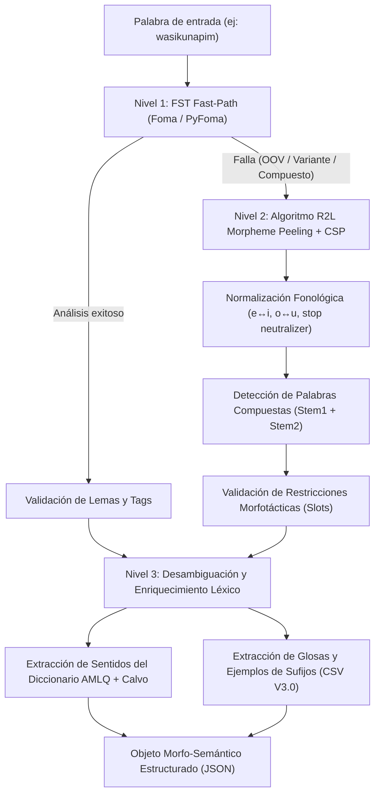

# Arquitectura del Traductor Generativo Quechua e Integración en AGY (Antigravity CLI)

Este documento especifica la arquitectura técnica de extremo a extremo para el **Traductor Generativo Quechua**, estructurado en tres etapas fundamentales (**Etapa 0: Indexación y Preparación**, **Etapa 1: Segmentación Morfo-Semántica**, y **Etapa 2: Traducción Generativa**), así como su empaquetado como **Plugin y Herramienta de Terminal para Antigravity CLI (`agy`)**.

---

## 1. Diagnóstico de Datos y Fuentes del Proyecto

El repositorio cuenta con recursos léxicos y gramaticales de alto valor lingüístico ubicados en `input/`:

1. **Diccionario AMLQ (`input/dictionaries/diccionario-qeswa-academia-mayor-cuzco.pdf`)**:
   - **Volumen**: 479 páginas.
   - **Estructura**: Dividido en dos secciones: Quechua → Español (págs. ~10–395) y Español → Quechua (págs. ~396–479).
   - **Variante lingüística**: Quechua Imperial / Cusco-Collao, con ortografía pentavocálica (*a, e, i, o, u*) y consonantismo complejo (oclusivas simples, aspiradas y glotalizadas: $p, ph, p'; t, th, t'; ch, chh, ch'; k, kh, k'; q, qh, q'$).
   - **Riqueza**: Contiene lemas, categorías gramaticales (`s.`, `v.`, `adj.`, `interj.`), acepciones separadas por plecas (`||`), ejemplos contextualizados (`EJEM: ...`), sinónimos (`SINÓN:`) y variantes regionales (`Pe.Aya:`, `Bol:`, `Ec:`).

2. **Diccionario Monumental de Julio Calvo Pérez (`input/dictionaries/DICCIONARIO-Quechua-espanol-VOL_1.pdf`)**:
   - **Volumen**: 2,042 páginas (Edición 2022, Fondo Editorial USMP).
   - **Contenido**: Volumen 1 corresponde a Español → Quechua de altísima densidad y precisión semántica.
   - **Riqueza semántica**: Incluye rasgos componenciales universales (`[corp.]`, `[anim.]`, `[veg.]`, `[mús.]`, `[±instr.]`, `[±compl.]`, etc.), registros sociolingüísticos (`«cult.»`, `«coloq.»`, `«fam.»`, `«desp.»`), marcas de frecuencia (`[+fr.]`, `[-fr.]`) y definiciones de diferenciación conceptual fina.
   - **Rol en el traductor**: Sirve como **índice de validación semántica inversa** y para enriquecer la desambiguación contextual cuando un término quechua tiene múltiples sentidos posibles.

3. **Base de Datos de Sufijos (`input/sufix/suffixes - V3.0.csv`)**:
   - **Volumen**: 245 registros tabulares limpios.
   - **Taxonomía**: Campos estructurados: `SUFIJO`, `TIPO` (Dependiente, Independiente, Otros), `SUBTIPO` (Nominal flexivo, Verbal flexivo, etc.), `CATEGORIA`, `SUBCATEGORIA` (Flexivo de caso, persona, número, etc.), `DEFINICION` y `EJEMPLOS` con traducciones al español.
   - **Inventario crítico**: Cubre tanto sufijos dependientes (nominales y verbales, flexivos y derivacionales) como sufijos independientes de orden superior (evidenciales/validadores: `-m/-mi`, `-s/-si`, `-chá`; conectivos: `-qa`, `-taq`, `-pas/-pis`, `-puni`, `-raq`, `-ña`, `-lla`, `-chu`).

4. **Antecedente `paqocha-fst` (`input/paqocha-fst/`)**:
   - Demostró la viabilidad de Foma FST con 13,750 entradas extraídas mediante regex simple.
   - **Limitaciones a superar**: Solo capturaba el primer sentido en palabras polisémicas (ej. ignoraba 20 de los 21 sentidos de *wasi*), omitía mayúsculas e interjecciones con `!`, y el binario FST fallaba ante variaciones ortográficas (pentavocálico vs. trivocálico) o palabras compuestas.

---

## 2. ETAPA 0: Arquitectura de Almacenamiento e Indexación

### 2.1. Selección Tecnológica: ¿Por qué SQLite FTS5 + Trie en Memoria?

Evaluamos cuatro alternativas de almacenamiento e indexación:

| Criterio | SQLite (FTS5 + B-Tree) | DuckDB | JSON en Memoria | DAWG / Trie Puro |
| :--- | :--- | :--- | :--- | :--- |
| **Tiempo de Lookup Exacto** | $< 0.5$ ms (B-Tree PK) | $\approx 2$ ms | $< 0.1$ ms (dict hash) | $< 0.05$ ms (recorrido $O(L)$) |
| **Búsqueda por Prefijo / Sufijo** | Muy rápido con `INDEX` | Regular | Lento (escaneo lineal) | **Óptimo** ($O(L)$) |
| **Búsqueda de Texto Completo (FTS)** | **Nativo y maduro (FTS5)** | Extensiones FTS | Inviable sin librerías externas | Inviable |
| **Manejo de Metadatos Ricos** | **Relacional completo** | Relacional tabular | Estructurado pero pesado | Nulo (solo claves) |
| **Persistencia y Portabilidad** | Un solo archivo `.db`, nativo en Python (`sqlite3`) | Archivo `.duckdb` | Archivos `.json` de 50MB+ | Binario serializado |
| **Footprint de Memoria** | Bajo ($\approx 10$–20 MB caché) | Medio ($\approx 50$–100 MB) | Alto (árbol de objetos Python) | Muy bajo ($\approx 5$ MB) |

#### Decisión de Diseño: Arquitectura Híbrida L1 / L2

1. **Nivel L1 (In-Memory Lexicon Index - Tiempo Real)**:
   - **Prefijo y Sufijo Tries** serializados (mediante `marisa-trie` o implementación pura en memoria) para las ~15,000 raíces normalizadas y los 245 sufijos.
   - Usado por el motor de segmentación de la Etapa 1 para poda ultra-rápida de candidatos.
2. **Nivel L2 (SQLite FTS5 - Base de Conocimiento Central `quechua_knowledge.db`)**:
   - Almacena el grafo completo de lemas, acepciones, ejemplos bilingües, variantes ortográficas y notas dialectales.
   - Tablas virtuales FTS5 con tokenizadores `unicode61` y `trigram` para búsquedas difusas (*fuzzy matching*) y recuperación contextual.

---

### 2.2. Esquema Relacional de Base de Datos (`quechua_knowledge.db`)

```sql
-- 1. Catálogo de fuentes bibliográficas
CREATE TABLE sources (
    source_id TEXT PRIMARY KEY,
    title TEXT NOT NULL,
    author TEXT NOT NULL,
    year INTEGER,
    edition TEXT,
    notes TEXT
);

-- 2. Lemas (Headwords) normalizados y canónicos
CREATE TABLE lemmas (
    lemma_id INTEGER PRIMARY KEY AUTOINCREMENT,
    headword TEXT NOT NULL,                -- Forma original del diccionario (ej: "allpaqa", "qheswa")
    headword_normalized TEXT NOT NULL,     -- Forma canónica trivocálica minúscula (ej: "allpaqa", "qhiswa")
    headword_phonetic TEXT NOT NULL,       -- Forma sin aspiraciones/glotalizaciones para fuzzy lookup
    pos TEXT NOT NULL,                     -- Categoría gramatical: s., v., adj., adv., interj., etc.
    dialect_origin TEXT DEFAULT 'cuz',     -- Región primaria: cuz, collao, aya, bol, etc.
    source_id TEXT NOT NULL REFERENCES sources(source_id),
    page_number INTEGER
);

CREATE INDEX idx_lemmas_hw ON lemmas(headword);
CREATE INDEX idx_lemmas_norm ON lemmas(headword_normalized);
CREATE INDEX idx_lemmas_phon ON lemmas(headword_phonetic);

-- 3. Acepciones semánticas (Senses) - Soporta polisemia completa
CREATE TABLE senses (
    sense_id INTEGER PRIMARY KEY AUTOINCREMENT,
    lemma_id INTEGER NOT NULL REFERENCES lemmas(lemma_id) ON DELETE CASCADE,
    sense_index INTEGER NOT NULL,          -- Orden de acepción (1, 2, 3...)
    definition_es TEXT NOT NULL,           -- Definición en español
    semantic_domain TEXT,                  -- [corp.], [anim.], [veg.], [mús.], etc.
    register_level TEXT,                   -- cult., coloq., desp., neol., lit.
    etymology TEXT                         -- Origen o étimo (aymara, puquina, español)
);

CREATE INDEX idx_senses_lemma ON senses(lemma_id);

-- 4. Ejemplos contextuales bilingües
CREATE TABLE examples (
    example_id INTEGER PRIMARY KEY AUTOINCREMENT,
    lemma_id INTEGER NOT NULL REFERENCES lemmas(lemma_id) ON DELETE CASCADE,
    sense_id INTEGER REFERENCES senses(sense_id) ON DELETE CASCADE,
    phrase_qu TEXT NOT NULL,               -- Oración / frase en Quechua
    translation_es TEXT NOT NULL,          -- Traducción registrada al español
    source_notes TEXT
);

CREATE INDEX idx_examples_lemma ON examples(lemma_id);

-- 5. Variantes ortográficas y dialectales registradas
CREATE TABLE lemma_variants (
    variant_id INTEGER PRIMARY KEY AUTOINCREMENT,
    lemma_id INTEGER NOT NULL REFERENCES lemmas(lemma_id) ON DELETE CASCADE,
    variant_form TEXT NOT NULL,
    dialect_code TEXT                      -- Pe.Aya, Bol, Ec, Jun, Arg, etc.
);

CREATE INDEX idx_variants_form ON lemma_variants(variant_form);

-- 6. Inventario formal de sufijos
CREATE TABLE suffixes (
    suffix_id INTEGER PRIMARY KEY AUTOINCREMENT,
    morpheme TEXT NOT NULL,                -- Forma canónica (ej: "MANTA", "NI", "KUNA")
    morpheme_clean TEXT NOT NULL,          -- Minúscula sin barras (ej: "manta", "ni")
    type TEXT NOT NULL,                    -- SUFIJO DEPENDIENTE, SUFIJO INDEPENDIENTE, OTROS
    subtype TEXT,                          -- DEPENDIENTE NOMINAL, etc.
    category TEXT,                         -- NOMINAL FLEXIVO, VERBAL DERIVACIONAL, etc.
    subcategory TEXT,                      -- FLEXIVO DE CASO, FLEXIVO DE PERSONA, etc.
    slot_order INTEGER NOT NULL,           -- Posición morfotáctica estricta (1..9)
    phonotactic_rule TEXT,                 -- vocal_only, consonant_only, euphony_ni, unrestricted
    definition TEXT NOT NULL,
    raw_examples TEXT
);

CREATE INDEX idx_suffixes_clean ON suffixes(morpheme_clean);
CREATE INDEX idx_suffixes_slot ON suffixes(slot_order);

-- 7. Alomorfos de sufijos
CREATE TABLE suffix_allomorphs (
    allomorph_id INTEGER PRIMARY KEY AUTOINCREMENT,
    suffix_id INTEGER NOT NULL REFERENCES suffixes(suffix_id) ON DELETE CASCADE,
    surface_form TEXT NOT NULL,            -- ej: "-q" vs "-paq"; "-m" vs "-mi"; "-s" vs "-si"
    context_condition TEXT NOT NULL        -- "post_vocalic", "post_consonantal"
);

CREATE INDEX idx_allomorphs_form ON suffix_allomorphs(surface_form);

-- 8. Tablas virtuales de búsqueda de texto completo FTS5
CREATE VIRTUAL TABLE lemmas_fts USING fts5(
    headword,
    headword_normalized,
    tokenize = 'unicode61 remove_diacritics 2'
);

CREATE VIRTUAL TABLE senses_fts USING fts5(
    definition_es,
    semantic_domain,
    content='senses',
    content_rowid='sense_id',
    tokenize = 'unicode61 remove_diacritics 2'
);
```

---

### 2.3. Pipeline de Extracción e Ingesta de Datos

El pipeline de ingesta (`src/indexer/`) opera de manera idempotente mediante los siguientes módulos:

1. **`amlq_extractor.py`**:
   - Usa `pymupdf` (`fitz`) para procesar las 479 páginas de `diccionario-qeswa-academia-mayor-cuzco.pdf`.
   - Implementa un parser de máquinas de estado que reconstruye oraciones partidas entre líneas o columnas.
   - Detecta límites de entrada con regex robusta tolerante a mayúsculas e interjecciones:
     ```python
     ENTRY_HEADER_RE = re.compile(
         r'^(?P<headword>[A-Za-zñ'\-]+)(?:[!.]|\s+)\s+(?P<pos>s\.|v\.|adj\.|adv\.|interj\.|pron\.|prep\.|conj\.)\s+(?P<rest>.*)$',
         re.IGNORECASE
     )
     ```
   - Segmenta acepciones delimitadas por `||` o numeradas `1.`, `2.`.
   - Extrae bloques `EJEM: ...` y asocia los ejemplos a su lema correspondiente.
   - Extrae variantes geográficas (`Pe.Aya:`, `Bol:`, `Ec:`).

2. **`calvo_extractor.py`**:
   - Procesa `DICCIONARIO-Quechua-espanol-VOL_1.pdf` (Julio Calvo Pérez).
   - Extrae pares semánticos Español → Equivalente Quechua, preservando los tags de dominio (`[corp.]`, `[mús.]`) y colocaciones.
   - Puebla la tabla de enriquecimiento léxico para proporcionar definiciones detalladas en la traducción inversa o desambiguación.

3. **`suffix_indexer.py`**:
   - Procesa `input/sufix/suffixes - V3.0.csv`.
   - Separa alomorfos explícitos (ej. `M / MI` $\rightarrow$ surface forms `-m` y `-mi`; `Q / PAQ` $\rightarrow$ `-q` tras vocal y `-paq` tras consonante).
   - Asigna de manera estricta la **ranura morfotáctica (*slot order*)** según la gramática quechua estándar:
     - *Ranura 1*: Derivación verbal (reflexivo `-ku`, causativo `-chi`, inceptivo `-ri`, etc.).
     - *Ranura 2*: Objeto verbal (`-wa` 1ra persona objeto).
     - *Ranura 3*: Tiempo/Aspecto (progresivo `-sha/-chka`, pasado `-rqa`, habitual `-q`, etc.).
     - *Ranura 4*: Sujeto verbal / Posesivo nominal (`-y`, `-yki`, `-n`, `-nchis`, etc.).
     - *Ranura 5*: Pluralizador nominal (`-kuna`).
     - *Ranura 6*: Casos nominales (`-ta`, `-man`, `-manta`, `-pi`, `-rayku`, `-kama`, etc.).
     - *Ranura 7*: Clíticos / Enclíticos independientes (tópico `-qa`, limitativo `-lla`, etc.).
     - *Ranura 8*: Evidenciales / Validadores (`-mi/-m`, `-si/-s`, `-chá`).
     - *Ranura 9*: Conectivos / Interrogativos (`-chu`, `-taq`, `-pas/-pis`).

---

## 3. ETAPA 1: Pipeline de Segmentación Morfo-Semántica

El Quechua es un idioma aglutinante y exclusivamente sufijante de orden de palabras SOV (Sujeto - Objeto - Verbo). Una sola palabra puede contener una raíz léxica y hasta 6 o 7 sufijos encadenados:

$$\text{Palabra} = \text{Raíz} + \text{Suf}_{1} + \text{Suf}_{2} + \dots + \text{Suf}_{k}$$

Ejemplo:
$$\text{pukllachishankumanmi} \implies \text{puklla (v.)} + \text{-chi (Caus)} + \text{-sha (Prog)} + \text{-nku (3Pl)} + \text{-man (Cond)} + \text{-mi (Valid)}$$

Para garantizar una segmentación 100% confiable y sin alucinaciones, implementamos una **arquitectura de segmentación en cascada de 3 niveles**:



### 3.1. Nivel 1: FST Determinista (Foma Fast-Path)
- Utiliza el transductor de estados finitos compilado (`quechua.fst`), derivado del archivo léxico `quechua.lexc`.
- Si la palabra pertenece al vocabulario estándar sin anomalías fonéticas, Foma la resuelve en menos de $0.1$ milisegundos retornando la secuencia canónica (ej. `wasi+N+Pl+Loc+Valid`).

### 3.2. Nivel 2: Desensamblaje Reverso (R2L Peeling) con Satisfacción de Restricciones (CSP)
Cuando una palabra no es reconocida por el FST (por ortografía pentavocálica, apóstrofes glotales distintos, neologismos o préstamos castellanizados):

1. **Pelado Reverso (Right-to-Left Morpheme Peeling)**:
   - Se examina la palabra desde el extremo derecho utilizando el Trie de sufijos indexado.
   - Se generan todas las posibles divisiones compatibles con las restricciones morfotácticas.
2. **Validación de Restricciones de Ranuras (Slot Constraints)**:
   - Un sufijo de ranura inferior (ej. caso, ranura 6) jamás puede preceder a un sufijo de derivación (ranura 1).
   - Incompatibilidades de categoría: una base verbal requiere un nominalizador (`-q`, `-na`, `-sqa`) antes de recibir sufijos de caso nominal (`-ta`, `-pi`, `-man`).
   - Fonotáctica: Se valida la presencia de `-ni-` eufónico cuando una raíz terminada en consonante recibe un sufijo posesivo (`yawar` + `-ni-` + `-y` $\rightarrow$ `yawarniy`).
3. **Normalización Fonológica de la Raíz Residual**:
   - Si el residuo no se encuentra en el índice de lemas, se aplican transformaciones fonológicas controladas:
     - **Trivocálico $\leftrightarrow$ Pentavocálico**: Conversión de vocales medias a altas ($e \rightarrow i$, $o \rightarrow u$). Ejemplo: `qheswa` $\rightarrow$ `qhiswa`.
     - **Neutralización de Oclusivas**: Mapeo de aspiradas/glotalizadas a simples ($k', kh \rightarrow k$; $t', th \rightarrow t$; $p', ph \rightarrow p$; $q', qh \rightarrow q$; $ch', chh \rightarrow ch$).
4. **Descomposición de Palabras Compuestas**:
   - Si la raíz no coincide pero tiene longitud $\ge 6$ caracteres, se evalúa si puede dividirse en $R_1 + R_2$ donde ambas son raíces registradas en el diccionario (ej. `allpa-mayu` $\rightarrow$ *tierra* + *río*).

### 3.3. Nivel 3: Desambiguación y Enriquecimiento Léxico
En quechua existen raíces altamente polisémicas (ej. *wasi* tiene 21 acepciones: casa, familia, templo, nido, cárcel, etc.).
- En lugar de devolver arbitrariamente la primera acepción (el error de `paqocha-fst`), el Nivel 3 extrae **todas las acepciones registradas con sus dominios semánticos y ejemplos bilingües**.
- Para los sufijos descompuestos, extrae su descripción pedagógica completa y los ejemplos correspondientes desde `suffixes - V3.0.csv`.
- Genera el objeto intermedio **Morfo-Semantic Scaffold**.

---

## 4. ETAPA 2: Prompt y Flujo de Traducción Generativa

### 4.1. El Problema de los LLMs con el Quechua
Los modelos de lenguaje comerciales (Gemini, Claude, GPT) fallan con frecuencia al traducir quechua debido a:
1. **Pérdida de Evidencialidad**: Traducen igual `-mi` (certeza testimonial personal), `-si` (reportativo: "dicen que / según cuentan") y `-chá` (conjetura: "tal vez / probablemente").
2. **Confusión de Clusividad**: Omiten la distinción entre primera persona plural incluyente (*ñoqanchis* / nosotros contigo) y excluyente (*ñoqayku* / nosotros sin ti).
3. **Alucinación de Raíces**: Inventan traducciones cuando una raíz tiene metáforas culturales andinas (ej. *pacha*, *ayllu*, *tinkuy*).

### 4.2. Estructura del Objeto Morfo-Semántico (Scaffold)

El pipeline de la Etapa 1 entrega al orquestador de traducción un scaffold estructurado en JSON:

```json
{
  "source_sentence": "Allpaqatam chharqoshanku.",
  "tokens": [
    {
      "surface": "Allpaqatam",
      "normalized": "allpaqa-ta-m",
      "stem": {
        "headword": "allpaqa",
        "pos": "s.",
        "senses": [
          {
            "index": 1,
            "definition": "Alpaca, paco. Camélido sudamericano de lana finísima.",
            "domain": "Zool."
          }
        ],
        "examples": [
          {
            "qu": "allpaqa chharqoy",
            "es": "apareamiento de alpacas en época de celo"
          }
        ]
      },
      "affixes": [
        {
          "morpheme": "-ta",
          "category": "NOMINAL FLEXIVO",
          "subcategory": "FLEXIVO DE CASO",
          "role": "Objeto Directo (Acusativo)",
          "meaning": "Marca el paciente u objeto sobre el cual recae la acción de un verbo no motriz."
        },
        {
          "morpheme": "-m",
          "category": "SUFIJO INDEPENDIENTE",
          "subcategory": "VALIDADOR",
          "role": "Evidencial Directo / Testifical",
          "meaning": "Indica que el hablante atestigua de primera mano o tiene certeza absoluta del hecho."
        }
      ]
    },
    {
      "surface": "chharqoshanku",
      "normalized": "chharqo-sha-nku",
      "stem": {
        "headword": "chharqoy",
        "pos": "v.",
        "senses": [
          {
            "index": 1,
            "definition": "Aparear alpacas o camélidos en celo previa selección.",
            "domain": "Ganad."
          }
        ]
      },
      "affixes": [
        {
          "morpheme": "-sha",
          "category": "VERBAL DERIVACIONAL",
          "subcategory": "ASPECTO PROGRESIVO",
          "role": "Acción en curso",
          "meaning": "Equivalente al gerundio ('estar haciendo'). Acción durativa presente."
        },
        {
          "morpheme": "-nku",
          "category": "VERBAL FLEXIVO",
          "subcategory": "FLEXIVO DE PERSONA",
          "role": "Sujeto 3ra Persona Plural",
          "meaning": "Ellos o ellas ejecutan la acción."
        }
      ]
    }
  ]
}
```

---

### 4.3. Diseño del Prompt para el LLM

El prompt suministra el scaffold al modelo estableciendo directivas lingüísticas formales e inquebrantables:

```text
Eres un lingüista especialista en lengua quechua (variante Cusco-Collao y Quechua Sureño) y traductor profesional al español.

Tu tarea es traducir la siguiente oración en Quechua al Español de forma fluida, exacta e idiomática, apoyándote ESTRICTAMENTE en el análisis morfo-semántico provisto.

### DIRECTIVAS LINGÜÍSTICAS OBLIGATORIAS:
1. EVIDENCIALIDAD EPISTÉMICA:
   - Si aparece el evidencial testimonial (-mi / -n): Traduce en tono indicativo asertivo directo (el hablante lo presenció o le consta).
   - Si aparece el evidencial reportativo (-si / -s): DEBES reflejar que es información de terceros ("dicen que...", "según cuentan...", "se dice que...").
   - Si aparece el evidencial conjetural (-chá): DEBES reflejar duda o deducción ("tal vez...", "quizás...", "probablemente...").
2. CLUSIVIDAD PRONOMINAL:
   - 1ra persona plural incluyente (-nchis): Implica "nosotros (incluyéndote a ti / al interlocutor)".
   - 1ra persona plural excluyente (-yku): Implica "nosotros (sin incluirte a ti)".
3. ROLES TEMÁTICOS Y CASOS:
   - -ta: Objeto directo o meta de movimiento.
   - -man: Hacia (dirección), destinatario u objeto indirecto.
   - -manta: Procedencia ('de', 'desde') o material.
   - -pi: Locativo ('en').
   - -wan: Instrumental ('con') o compañía.
   - -paq: Beneficiario ('para').
4. POLISEMIA Y DESAMBIGUACIÓN CONTEXTUAL:
   - Entre las acepciones proporcionadas en el diccionario para cada raíz, selecciona la que guarde perfecta concordancia semántica con los argumentos del verbo y el campo contextual.
5. NATURALIDAD Y PRECISIÓN:
   - La traducción al español debe ser gramaticalmente impecable y natural, sin sonar a traducción palabra por palabra, pero sin suprimir ningún matiz funcional de los sufijos.

---
### DATOS DE ENTRADA:
Oración Original Quechua:
"{source_sentence}"

Andamiaje Morfo-Semántico (Análisis de Raíces y Sufijos):
{scaffold_json}

---
### FORMATO DE RESPUESTA REQUERIDO:
Responde en formato JSON con la siguiente estructura:
{
  "traduccion_es": "<traducción final en español>",
  "traduccion_literal_glosada": "<glosa interlineal morfema por morfema>",
  "evidencialidad": "<análisis de certeza o fuente de información>",
  "clusividad": "<análisis de inclusión/exclusión si aplica, o null>",
  "justificacion_semantica": "<breve justificación de las acepciones seleccionadas para las raíces polisémicas>"
}
```

---

## 5. Integración con AGY (Antigravity CLI) y Packaging

Antigravity proporciona dos mecanismos de integración complementarios:
1. **Plugin de Workspace/Global (`.agents/plugins/quechua-translator/`)**: Inyecta herramientas MCP, reglas de comportamiento (`AGENTS.md`) y skills interactivos (`SKILL.md`) directamente en la sesión de Antigravity (IDE, App y CLI).
2. **Herramienta de Terminal de Línea de Comandos (`qtr`)**: Un ejecutable CLI independiente para scripting, terminal pura y flujos desatendidos.

### 5.1. Estructura del Plugin para AGY

El plugin se ubica en `.agents/plugins/quechua-translator/`:

```text
.agents/plugins/quechua-translator/
├── plugin.json                 # Manifiesto del plugin
├── mcp_config.json             # Configuración del servidor MCP local
├── rules/
│   └── AGENTS.md               # Reglas lingüísticas y directivas activas
└── skills/
    ├── quechua-translate/      # Skill: Traducción oracional guiada
    │   └── SKILL.md
    └── quechua-morphology/     # Skill: Análisis y consulta de sufijos/raíces
        └── SKILL.md
```

#### Manifiesto `plugin.json`
```json
{
  "name": "quechua-translator",
  "description": "Traductor generativo Quechua-Español con segmentación morfo-semántica determinista basada en FST y diccionarios oficiales.",
  "version": "1.0.0"
}
```

#### Servidor MCP `mcp_config.json`
El plugin expone un servidor MCP local vía transporte Stdio para que el agente en `agy` invoque directamente las capacidades analíticas:

```json
{
  "mcpServers": {
    "quechua-engine": {
      "command": "python3",
      "args": ["-m", "src.mcp_server"],
      "env": {
        "QUECHUA_DB_PATH": "data/quechua_knowledge.db",
        "QUECHUA_FST_PATH": "data/quechua.fst"
      }
    }
  }
}
```

Las herramientas expuestas por `src.mcp_server` son:
- `quechua_segment(text: str)`: Descompone cualquier oración en raíces normalizadas, sufijos, ranuras y etiquetas lingüísticas.
- `quechua_lookup_lemma(word: str)`: Consulta lemas en SQLite FTS5, retornando todas las acepciones, ejemplos del diccionario AMLQ y notas de Calvo Pérez.
- `quechua_lookup_suffix(suffix: str)`: Consulta funciones gramaticales, alomorfos, ranura y ejemplos del catálogo de 245 sufijos.
- `quechua_translate(text: str, options: dict)`: Ejecuta el pipeline completo de traducción asistida por scaffold morfo-semántico.

#### Reglas del Plugin `rules/AGENTS.md`
```markdown
# Directivas Lingüísticas de Quechua para Antigravity

Al interactuar con textos en Quechua o traducir entre Quechua y Español:

1. **Prioridad de Herramientas**: Utiliza SIEMPRE la herramienta MCP `quechua_segment` antes de proponer una traducción. Nunca adivines la raíz ni asumas el significado sin verificar la segmentación de sufijos.
2. **Evidenciales Obligatorios**: Respeta estrictamente los evidenciales (-mi, -si, -chá). Un error en evidencialidad altera la validez legal y epistémica de la oración.
3. **Manejo de Polisemia**: Si la herramienta indica que una raíz tiene múltiples acepciones (ej. *wasi*, *allpa*), examina el contexto de los argumentos oracionales para seleccionar el sentido adecuado y justificarlo.
4. **Respeto a Variantes Ortográficas**: El sistema normaliza internamente variantes pentavocálicas (AMLQ) y trivocálicas (Ministerio de Educación / Collao). Conserva la convención ortográfica preferida por el usuario en la salida final.
```

---

### 5.2. Herramienta de Terminal de Línea de Comandos (`qtr`)

Para uso directo en bash o terminal de Linux, se implementa una interfaz CLI con subcomandos:

```bash
# 1. Indexar diccionarios PDF y CSV en la base SQLite FTS5
qtr index --amlq input/dictionaries/diccionario-qeswa-academia-mayor-cuzco.pdf \
          --calvo input/dictionaries/DICCIONARIO-Quechua-espanol-VOL_1.pdf \
          --suffixes "input/sufix/suffixes - V3.0.csv" \
          --output data/quechua_knowledge.db

# 2. Analizar y segmentar una palabra u oración (salida enriquecida en terminal con colores)
qtr segment "Wasikunapim tiyashanku"

# 3. Consultar una raíz o palabra en los diccionarios indexados
qtr lookup "allpaqa"

# 4. Consultar un sufijo en la base de datos
qtr suffix "manta"

# 5. Traducir una oración quechua a español
qtr translate "Orqoman atuq rishanmi"
```

---

## 6. Estructura Completa de Archivos y Carpetas del Proyecto

```text
generative-quechua-translator/
├── .agents/                                # Customizaciones para Antigravity (AGY)
│   └── plugins/
│       └── quechua-translator/
│           ├── plugin.json                 # Manifiesto del plugin
│           ├── mcp_config.json             # Exposición de herramientas MCP
│           ├── rules/
│           │   └── AGENTS.md               # Reglas lingüísticas
│           └── skills/
│               ├── quechua-translate/
│               │   └── SKILL.md            # Runbook de traducción contextual
│               └── quechua-morphology/
│                   └── SKILL.md            # Runbook de análisis morfológico
├── bin/
│   └── qtr                                 # Wrapper ejecutable de terminal
├── config/
│   └── settings.yaml                       # Configuración de rutas, umbrales y modelos
├── data/                                   # Artefactos compilados e indexados
│   ├── quechua_knowledge.db                # Base de datos SQLite FTS5 (L2)
│   ├── quechua.fst                         # Binario compilado Foma FST
│   └── quechua.lexc                        # Lexicón morfotáctico fuente
├── docs/                                   # Documentación técnica y especificaciones
│   ├── architecture_and_agy_plugin_design.md
│   └── dictionary_extraction_specs.md
├── input/                                  # Corpus original
│   ├── dictionaries/
│   │   ├── DICCIONARIO-Quechua-espanol-VOL_1.pdf
│   │   └── diccionario-qeswa-academia-mayor-cuzco.pdf
│   └── sufix/
│       └── suffixes - V3.0.csv
├── src/                                    # Código fuente principal
│   ├── __init__.py
│   ├── cli.py                              # Entrypoint del comando de terminal `qtr`
│   ├── mcp_server.py                       # Servidor MCP stdio para Antigravity
│   │
│   ├── indexer/                            # ETAPA 0: Indexación y Almacenamiento
│   │   ├── __init__.py
│   │   ├── amlq_parser.py                  # Extractor de diccionario AMLQ Cusco
│   │   ├── calvo_parser.py                 # Extractor de diccionario Julio Calvo Pérez
│   │   ├── suffix_parser.py                # Extractor y normalizador del CSV de sufijos
│   │   ├── schema.sql                      # DDL de tablas e índices FTS5
│   │   └── db_builder.py                   # Orquestador de carga a SQLite
│   │
│   ├── segmentation/                       # ETAPA 1: Segmentación Morfo-Semántica
│   │   ├── __init__.py
│   │   ├── fst_engine.py                   # Wrapper de ejecución Foma FST
│   │   ├── peeling_engine.py               # Desensamblador R2L con morfotáctica CSP
│   │   ├── normalizer.py                   # Normalizador fonológico (trivocálico/pentavocálico)
│   │   ├── compound_splitter.py            # Descompositor de palabras compuestas
│   │   └── disambiguator.py                # Selector de acepciones y ejemplos del diccionario
│   │
│   ├── translation/                        # ETAPA 2: Traducción Generativa
│   │   ├── __init__.py
│   │   ├── scaffold_builder.py             # Generador del JSON Morfo-Semántico
│   │   ├── prompt_templates.py             # Plantillas de prompts especializadas
│   │   └── llm_orchestrator.py             # Orquestador con verificación y post-proceso
│   │
│   └── storage/                            # Capa de Acceso a Datos
│       ├── __init__.py
│       ├── db.py                           # Conexión SQLite y consultas optimizadas
│       └── models.py                       # Dataclasses (Lemma, Sense, Suffix, Scaffold)
│
├── tests/                                  # Suite de pruebas automatizadas
│   ├── test_indexer.py                     # Validación de extracción y FTS5
│   ├── test_segmentation.py                # Casos morfológicos de prueba
│   └── test_translation_prompt.py          # Verificación de ensamblado de prompts
│
├── pyproject.toml                          # Gestión de dependencias (uv / pip)
├── .gitignore
└── README.md
```

---

## 7. Plan de Implementación por Fases

| Fase | Entregable Clave | Criterio de Éxito |
| :--- | :--- | :--- |
| **Fase 1 (ETAPA 0)** | Scripts `amlq_parser.py`, `calvo_parser.py`, `suffix_parser.py` y `db_builder.py`. Base `data/quechua_knowledge.db`. | $> 14,000$ lemas con acepciones completas y ejemplos indexados; 245 sufijos con ranuras en SQLite FTS5; consultas FTS $< 5$ ms. |
| **Fase 2 (ETAPA 1)** | Módulos `fst_engine.py`, `peeling_engine.py`, `normalizer.py` y `disambiguator.py`. | Cobertura de segmentación $> 95\%$ en oraciones complejas de prueba; extracción de múltiples acepciones y ejemplos para palabras polisémicas. |
| **Fase 3 (ETAPA 2)** | Módulos `scaffold_builder.py`, `prompt_templates.py` y `llm_orchestrator.py`. | Generación determinista del andamiaje morfo-semántico en JSON; traducción precisa preservando evidencialidad y clusividad. |
| **Fase 4 (Packaging)** | Manifiesto `.agents/plugins/quechua-translator/`, servidor `mcp_server.py`, `rules/AGENTS.md`, Skills y CLI `bin/qtr`. | Comando `qtr` operativo en terminal; herramientas MCP detectadas y ejecutables de forma nativa en `agy`. |
